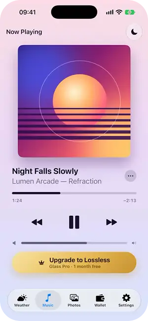
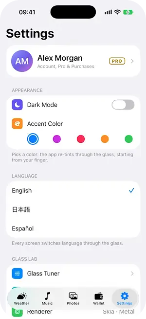
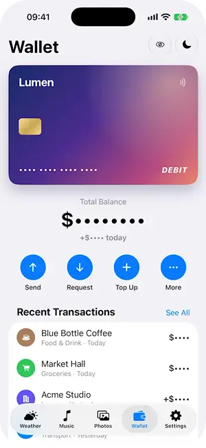
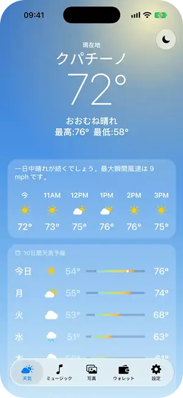
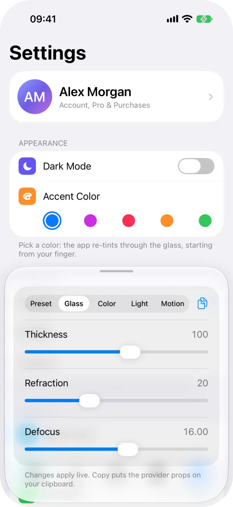

<p align="center">
  <picture>
    <source media="(prefers-color-scheme: dark)" srcset="https://raw.githubusercontent.com/GeorgiLucasEdwin/react-native-glass-transitions/main/.github/assets/banner-dark.svg">
    
  </picture>
</p>

<h3 align="center">Any state change, through a lens of glass.</h3>

<p align="center">A React Native library for iOS.</p>

<p align="center">
  <a href="https://www.npmjs.com/package/react-native-glass-transitions"></a>
  <a href="https://github.com/GeorgiLucasEdwin/react-native-glass-transitions/actions/workflows/ci.yml"></a>
  <a href="LICENSE"></a>
  
  
</p>

<p align="center">
  
</p>

<p align="center"><b>Night falls.</b><br>One tap. A lens of glass sweeps across the screen, bending what it passes, and leaves the new state behind it.</p>

## Any state change.

Not just dark mode. Wrap the change in `transition()` and the glass reveals it.

<table>
  <tr>
    <td align="center" width="25%"></td>
    <td align="center" width="25%"></td>
    <td align="center" width="25%"></td>
    <td align="center" width="25%"></td>
  </tr>
  <tr>
    <td align="center"><b>Unlock Pro.</b><br><sub>From the Buy button.</sub></td>
    <td align="center"><b>Switch language.</b><br><sub>English to 日本語.</sub></td>
    <td align="center"><b>Reveal a balance.</b><br><sub>From the eye button.</sub></td>
    <td align="center"><b>Change tabs.</b><br><sub>From the tapped tab.</sub></td>
  </tr>
</table>

## Install

```sh
npx expo install react-native-glass-transitions @shopify/react-native-skia react-native-reanimated react-native-worklets expo-haptics
```

`expo-haptics` is optional. Without it, haptics are a no-op. The [tuner](#tune-it-live) also needs `@expo/ui` and `expo-clipboard`.

**Requirements**

- **iOS** only, for now. On Android and web every change applies instantly, without a sweep.
- An Expo **development build** or a bare React Native app. Not Expo Go.
- The **New Architecture**.
- `react` >= 19, `react-native` >= 0.88, `@shopify/react-native-skia` >= 2.14, `react-native-reanimated` >= 4.7, `react-native-worklets` >= 0.13.

## Quick start

Wrap your app once. Then route a state change through the glass.

```tsx
import { useState } from 'react';
import { Switch, View } from 'react-native';
import { GlassTransitionProvider, useGlassSource } from 'react-native-glass-transitions';

export default function App() {
  return (
    <GlassTransitionProvider preset="glass">
      <Screen />
    </GlassTransitionProvider>
  );
}

function Screen() {
  const [dark, setDark] = useState(false);
  const [on, setOn] = useState(dark); // the switch's own value: it flips at once, the screen follows
  const source = useGlassSource();
  return (
    <View style={{ flex: 1, backgroundColor: dark ? '#000' : '#fff' }}>
      {/* The switch stays live through the sweep, and the snapshot starts on touch-down. */}
      <View {...source.props}>
        <Switch
          value={on}
          onValueChange={(v) => {
            setOn(v);
            source.transition(() => setDark(v));
          }}
        />
      </View>
    </View>
  );
}
```

That's it. Night falls from the top. Day rises from the bottom.

> The change is applied a couple of frames after the tap, once the old screen is captured. A controlled control (like React Native's `Switch`) would bounce back in the meantime, so give it its own state and flip that at once, as above.

## Recipes

### Any state change

`transition(apply)` snapshots the screen, runs `apply`, and sweeps the glass from the old frame to the new one. Anything that changes what's on screen works: a theme, a language, a purchase, a tab.

```tsx
import { Button, View } from 'react-native';
import { useGlassSource, useGlassTransition } from 'react-native-glass-transitions';

function Paywall() {
  const buy = useGlassSource(); // the Buy button stays live; the glass can start from it
  return (
    <View {...buy.props}>
      <Button title="Unlock Pro" onPress={() => buy.transition(() => setPro(true), { origin: 'source' })} />
    </View>
  );
}

function LanguagePicker() {
  const { transition } = useGlassTransition(); // no source control needed
  return <Button title="日本語" onPress={() => transition(() => setLanguage('ja'), { origin: 'touch' })} />;
}
```

It returns a promise that resolves once the overlay is gone:

```ts
const result = await transition(() => setTheme('dark')); // 'animated' | 'instant' | 'skipped'
```

### Drag the glass



`useGlassScrub` puts the glass under a finger. `begin` snapshots and applies the change, the gesture writes `target` (0 to 1) on the UI thread, and `end` commits or reverts.

This pull-to-darken uses [react-native-gesture-handler](https://docs.swmansion.com/react-native-gesture-handler/) 3:

```tsx
import type { ReactNode } from 'react';
import { Appearance, useWindowDimensions } from 'react-native';
import { GestureDetector, usePanGesture } from 'react-native-gesture-handler';
import { scheduleOnRN } from 'react-native-worklets';
import { useGlassScrub } from 'react-native-glass-transitions';

function PullToDarken({ children }: { children: ReactNode }) {
  const { height } = useWindowDimensions();
  const scrub = useGlassScrub();
  const begin = () => {
    const next = Appearance.getColorScheme() !== 'dark';
    scrub.begin(
      () => setScheme(next),
      () => setScheme(!next),
      { origin: 'top' },
    );
  };
  const pan = usePanGesture({
    activeOffsetY: 15,
    onActivate: () => {
      'worklet';
      scheduleOnRN(begin);
    },
    onUpdate: (e) => {
      'worklet';
      scrub.target.set(e.translationY / (height * 0.75));
    },
    onDeactivate: (e) => {
      'worklet';
      scheduleOnRN(scrub.end, e.translationY > height / 3 || e.velocityY > 1000);
    },
  });
  return <GestureDetector gesture={pan}>{children}</GestureDetector>;
}
```

`setScheme`, like `setPro` and `setLanguage` above, stands for your own state setter. Let go past a third (or flick) to commit; otherwise the glass slides back and `revert` runs.

<br clear="right">

### Pick a look

Four presets. Start with one, then override any value.

| Preset   |                                                                         |
| -------- | ----------------------------------------------------------------------- |
| `subtle` | Barely there: a thin lens, ready for production UI.                     |
| `glass`  | Frosted, color-warped glass with a slow, settling reveal. **Default.**  |
| `liquid` | Thick, clear lens with a bright rim, in the spirit of iOS Liquid Glass. |
| `prism`  | Heavy prism: rainbow edges and soft focus.                              |

```tsx
<GlassTransitionProvider preset="liquid" config={{ duration: 900, band: 60 }}>
```

Per call, too: `transition(apply, { preset: 'subtle' })`. Options on the call win over the tuner, which wins over the provider's props.

### Choose where it starts

The default origin is `'auto'`: when the screen gets darker, night falls from the top. When it gets lighter, day rises from the bottom. Or pick one:

| Origin                          | Starts                                                                   |
| ------------------------------- | ------------------------------------------------------------------------ |
| `'auto'`                        | From the top when the screen darkens, from the bottom when it brightens. |
| `'touch'`                       | Where the finger last touched.                                           |
| `'source'`                      | At the center of the live control.                                       |
| `'top'`, `'center'`, `'bottom'` | There.                                                                   |
| `{ x, y }`                      | At a point in window coordinates, like a touch's `pageX` / `pageY`.      |

### Tune it live



A SwiftUI bottom sheet to shape the glass on device. Changes apply to the next transition. **Copy** puts the provider props on your clipboard, ready to paste.

It needs `@expo/ui` and `expo-clipboard`, so it lives in its own entry. Keep it out of production builds.

```tsx
import { GlassTuner } from 'react-native-glass-transitions/tuner';

<GlassTuner open={open} onOpenChange={setOpen} />;
```

`useGlassTuner()` (same entry) gives the live overrides: `config`, `preset`, `origin`, their setters, and `reset()`.

<br clear="right">

## Made to feel native

- **The control stays live.** Wrap it with `useGlassSource` and the switch keeps animating through the sweep, instead of freezing in the snapshot.
- **It starts on touch-down.** The snapshot begins as the finger lands, which saves about 60 ms.
- **Night falls, day rises.** The `'auto'` origin follows how the screen's brightness changes. Toward a darker screen the glass turns smoky and cool, toward a lighter one bright and warm.
- **Haptics.** A light tap as the sweep starts, a soft one as it lands. Off with `haptics={false}`.
- **Reduce Motion.** Checked at the start of every transition. When it's on, changes apply instantly.
- **The status bar follows the glass,** then hands back your own `<StatusBar>` style.
- **Nothing moves under the glass.** Touches are blocked app-wide for the whole transition, drags included.
- **Interruptible.** A new transition makes the running one jump to its end first. A drag still in progress is reverted instead.

## API

```ts
import {
  GlassTransitionProvider,
  useGlassTransition,
  useGlassSource,
  useGlassScrub,
  presets,
  type GlassConfig,
  type GlassOrigin,
  type GlassPreset,
  type GlassResult,
  type GlassSourceHandle,
  type GlassTransitionOptions,
} from 'react-native-glass-transitions';

import { GlassTuner, useGlassTuner } from 'react-native-glass-transitions/tuner';
```

### `<GlassTransitionProvider>`

Wrap your app (or the subtree to animate) once.

| Prop              | Type                   | Default   |                                                                                                                                          |
| ----------------- | ---------------------- | --------- | ---------------------------------------------------------------------------------------------------------------------------------------- |
| `preset`          | `GlassPreset`          | `'glass'` | Starting look.                                                                                                                           |
| `config`          | `Partial<GlassConfig>` |           | Overrides on top of the preset, e.g. pasted from the tuner.                                                                              |
| `origin`          | `GlassOrigin`          | `'auto'`  | Default origin for every transition.                                                                                                     |
| `haptics`         | `boolean`              | `true`    | Haptic taps at the start and end of a sweep. No-op without `expo-haptics`.                                                               |
| `backgroundColor` | `ColorValue`           |           | Painted behind your app inside the provider. Set it if your root is transparent, so see-through areas don't turn black in the snapshots. |

### `useGlassTransition()`

Returns `{ transition }`.

`transition(apply, options?): Promise<GlassResult>` runs any state change behind a glass sweep. It resolves once the sweep is over and the overlay is gone. A call while another sweep runs makes that one jump to its end first. It rejects (after cleanup) if `apply` throws.

### `useGlassSource()`

For the control that triggers the change: a switch, a button.

| Member                        |                                                                                                                 |
| ----------------------------- | --------------------------------------------------------------------------------------------------------------- |
| `props`                       | Spread on a `View` wrapping the control. Keeps it live through the sweep and starts the snapshot on touch-down. |
| `handle`                      | A `GlassSourceHandle`, to pass as `live` to other transitions.                                                  |
| `transition(apply, options?)` | Like `useGlassTransition().transition`, with `live` defaulting to this source.                                  |

### `useGlassScrub()`

Drive the glass with a gesture.

| Member                              |                                                                                                                                                                                                       |
| ----------------------------------- | ----------------------------------------------------------------------------------------------------------------------------------------------------------------------------------------------------- |
| `begin(apply, revert, options?)`    | A gesture started: snapshot, apply, and let the glass follow `target`. `revert` undoes `apply` on cancel.                                                                                             |
| `target`                            | `SharedValue<number>`. Where the finger wants the glass, 0 to 1. Write it from UI-thread worklets with `target.set(…)`.                                                                               |
| `update(target)`                    | JS convenience for `target.set(target)`.                                                                                                                                                              |
| `end(commit): Promise<GlassResult>` | Let go: finish (`true`) or cancel and revert (`false`). Resolves once the overlay is gone. Without a matching `begin`, resolves `'skipped'`. Unmounting or backgrounding the app mid-drag cancels it. |

### `GlassTransitionOptions`

Per-call overrides. They win over the tuner, which wins over the provider's props.

| Option   | Type                   |                                                                           |
| -------- | ---------------------- | ------------------------------------------------------------------------- |
| `origin` | `GlassOrigin`          | Where the glass starts.                                                   |
| `live`   | `GlassSourceHandle`    | A control that stays live (not frozen in the snapshots) during the sweep. |
| `preset` | `GlassPreset`          | Look for this call only.                                                  |
| `config` | `Partial<GlassConfig>` | Overrides on top of the preset, for this call only.                       |

### `GlassResult`

| Value        |                                                                                                                                                                               |
| ------------ | ----------------------------------------------------------------------------------------------------------------------------------------------------------------------------- |
| `'animated'` | The glass swept and the change is in.                                                                                                                                         |
| `'instant'`  | The change is in, without a sweep: Reduce Motion, not iOS, nothing visibly changed, the snapshot failed, or a newer transition cut this one short before it started sweeping. |
| `'skipped'`  | No change: a scrub was cancelled (and reverted, or ended before anything was shown), or `end` came without `begin`.                                                           |

### `GlassConfig`

Every preset in `presets` is a full `GlassConfig`. Values are clamped to >= 0 (`band` to 1 – 300). The range is what the tuner's slider covers.

| Key          | Tuner label | Range      |                                                                          |
| ------------ | ----------- | ---------- | ------------------------------------------------------------------------ |
| `band`       | Thickness   | 16 – 160   | Glass thickness, in points.                                              |
| `refraction` | Refraction  | 0 – 60     | How much the glass bends what's behind it.                               |
| `blur`       | Defocus     | 0 – 28     | Defocus under the glass, in points.                                      |
| `disperse`   | Color Warp  | 0 – 2      | Red and blue bend by different amounts.                                  |
| `fringe`     | Fringe      | 0 – 20     | Extra red/blue split across the whole glass, in points.                  |
| `mood`       | Mood        | 0 – 1      | Tint strength: smoky and cool toward dark, bright and warm toward light. |
| `spec`       | Highlight   | 0 – 1.5    | Highlight strength.                                                      |
| `fresnel`    | Edge Glow   | 0 – 0.5    | Soft bright edge.                                                        |
| `shadow`     | Shadow      | 0 – 0.2    | Soft shadow just ahead of the glass.                                     |
| `settle`     | Settle      | 0 – 0.4    | The new state starts slightly magnified behind the glass, then settles.  |
| `duration`   | Duration    | 300 – 3500 | Sweep length, in ms.                                                     |

## Caveats

- **The provider must wrap the full screen it animates.** The sweep is drawn over the provider's own view, from snapshots of it. Anything outside (a native modal, a view above the provider) is not part of it.
- **One live control per transition.** A single hole is cut in the overlay for the `live` control.
- **Coasting scroll views.** Touches are blocked while a transition runs, but a scroll view still coasting from a fling keeps moving underneath, so its content may appear shifted when the overlay lifts.
- **Status bar.** iOS draws it above everything, so its style follows the glass: the provider pushes an entry on React Native's `StatusBar` stack during a sweep and pops it after.
- **Android and web** are not supported yet. Changes apply instantly.

## Example app

The Expo app in [`example/`](example) shows real use cases (Weather, Music, Photos, Wallet, Settings) and resolves the library straight from `src/`.

```sh
cd example
npm install
npx expo run:ios     # builds the dev client
npm start            # Metro
```

## Contributing

Issues and pull requests are welcome. See [CONTRIBUTING.md](CONTRIBUTING.md) for setup, and run this before opening a PR:

```sh
npm run check   # typecheck, lint, format, tests, build
```

## License

[MIT](LICENSE)
