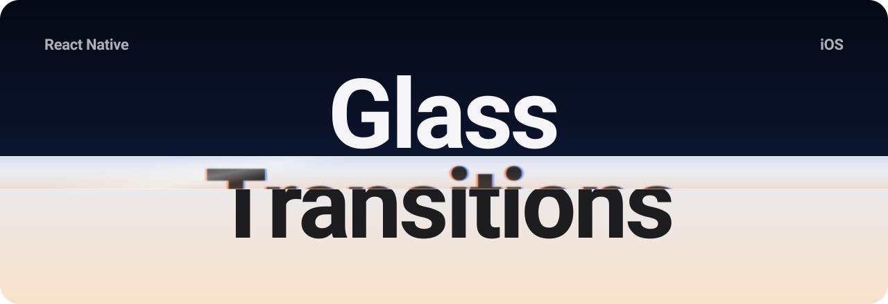

<p align="center">
  <picture>
    <source media="(prefers-color-scheme: dark)" srcset="https://raw.githubusercontent.com/GeorgiLucasEdwin/react-native-glass-transitions/main/.github/assets/banner-dark.svg">
    
  </picture>
</p>

<p align="center">Any state change, through a lens of glass. React Native, iOS.</p>

## Install

```sh
npx expo install react-native-glass-transitions @shopify/react-native-skia react-native-reanimated react-native-worklets expo-haptics
```

iOS only. Expo dev build or bare React Native (not Expo Go), New Architecture.

## Use

```tsx
import { GlassTransitionProvider, useGlassSource } from 'react-native-glass-transitions';

<GlassTransitionProvider>
  <App />
</GlassTransitionProvider>;

function DarkModeSwitch() {
  const [on, setOn] = useState(dark);
  const source = useGlassSource();
  return (
    <View {...source.props}>
      <Switch
        value={on}
        onValueChange={(v) => {
          setOn(v); // flip the switch now; the change lands after the snapshot
          source.transition(() => setDark(v));
        }}
      />
    </View>
  );
}
```

Any state change works: `useGlassTransition().transition(() => setTab('music'))`.

## API

- `<GlassTransitionProvider preset? config? origin? haptics? backgroundColor?>`
- `useGlassTransition()` → `transition(apply, { origin, live, preset, config })` → `'animated' | 'instant' | 'skipped'`
- `useGlassSource()` → `{ props, handle, transition }`
- `useGlassScrub()` → `{ begin(apply, revert), target, update, end(commit) }` for gestures
- Presets: `subtle`, `glass`, `liquid`, `prism`. Origins: `auto`, `touch`, `source`, `top`, `center`, `bottom`, `{ x, y }`.
- Dev tuner: `import { GlassTuner } from 'react-native-glass-transitions/tuner'`.

## License

MIT
